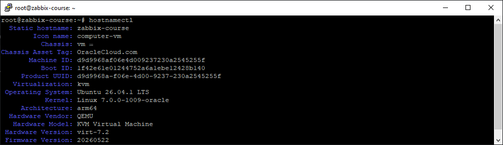
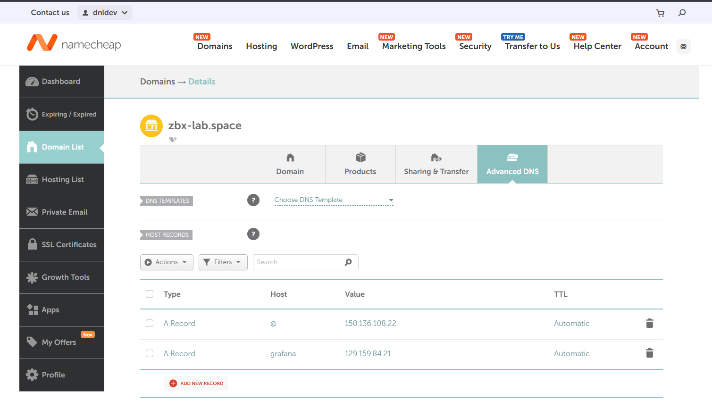
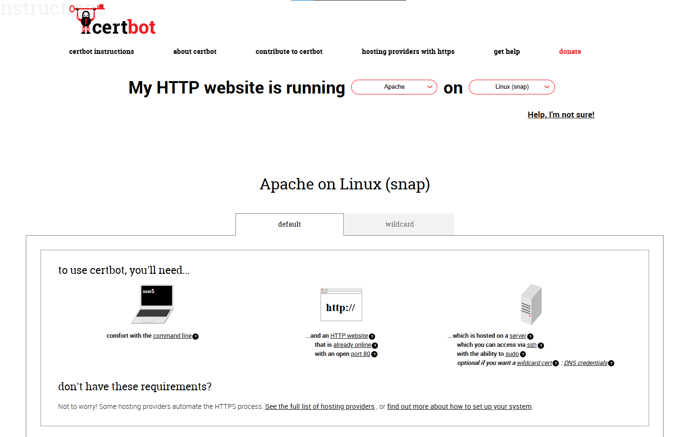

#  Módulo 1: Fundação, Infraestrutura e Segurança de Perímetro

Documentação técnica passo a passo da implementação da infraestrutura base do laboratório de observabilidade com **Zabbix 7.0 LTS** na **Oracle Cloud Infrastructure (OCI)**, abrangendo o provisionamento em nuvem, estruturação do banco de dados **MySQL**, servidor web **Apache**, certificação **SSL/TLS (Certbot)** e blindagem de perímetro via **Firewall**.

---

##  Passo 1: Provisionamento da Máquina Virtual em Nuvem

O ambiente foi planejado para operar em regime contínuo (24/7) com alta disponibilidade e acesso remoto seguro para conectar múltiplos hosts distribuídos.

* **Migração de Ambiente:** Os testes iniciais ocorreram na Vultr durante o período de avaliação gratuito e, em seguida, toda a arquitetura foi reconstruída do zero de forma definitiva na **Oracle Cloud Infrastructure (OCI)**.
* **Região e Instância:** Região `US East (Ashburn)`, instância nomeada `zabbix-course` sob o shape **VM.Standard.A1.Flex** (1 OCPU e 6 GB de RAM).
* **Sistema Operacional e Arquitetura:** Ubuntu 26.04.1 LTS Minimal em arquitetura ARM64 (`aarch64`) com Kernel Linux `7.0.0-1009-oracle`.
* **Endereçamento de Rede:** IP Privado `10.0.0.161` e IP Público `150.136.108.22`, com administração remota via protocolo SSH utilizando o cliente **PuTTY**.

### Validação da Arquitetura no Terminal
Após estabelecer a conexão via SSH, o comando abaixo foi executado para confirmar a versão do sistema operacional e a arquitetura do processador antes do download dos pacotes:

```bash
hostnamectl
```

Saída registrada no servidor:




---

##  Passo 2: Instalação do Repositório e Pacotes do Zabbix 7.0 LTS

Com o sistema operacional validado, foi realizado o download do repositório oficial do Zabbix 7.0 LTS (pacote compatível com a arquitetura `arm64`) e a instalação do servidor central, interface web PHP, configurações do Apache, scripts SQL e agente local.

### 1. Baixar e instalar o pacote do repositório oficial
```bash
wget https://repo.zabbix.com/zabbix/7.0/ubuntu-arm64/pool/main/z/zabbix-release/zabbix-release_latest_7.0+ubuntu26.04_all.deb
dpkg -i zabbix-release_latest_7.0+ubuntu26.04_all.deb
apt update
```

### 2. Confirmar a disponibilidade e instalar os componentes do Zabbix
```bash
apt search zabbix
sudo apt install -y zabbix-server-mysql zabbix-frontend-php zabbix-apache-conf zabbix-sql-scripts zabbix-agent
```

---

##  Passo 3: Instalação e Estruturação do Banco de Dados MySQL

A persistência de configurações, histórico e tendências utiliza o **MySQL Server** configurado com conjunto de caracteres `utf8mb4` e agrupamento binário `utf8mb4_bin`.

### 1. Instalar e validar o serviço do MySQL Server
```bash
sudo apt install -y mysql-server
sudo systemctl start mysql
sudo systemctl status mysql
```

### 2. Criar o banco de dados e o usuário exclusivo do Zabbix
Acesse o console do MySQL (`sudo mysql`) e execute as instruções SQL abaixo:

```sql
CREATE DATABASE zabbix CHARACTER SET utf8mb4 COLLATE utf8mb4_bin;
CREATE USER 'zabbix'@'localhost' IDENTIFIED BY '<SUA_SENHA_AQUI>';
GRANT ALL PRIVILEGES ON zabbix.* TO 'zabbix'@'localhost';
SET GLOBAL log_bin_trust_function_creators = 1;
QUIT;
```

> **Nota Técnica:** A variável global `log_bin_trust_function_creators = 1` é ativada temporariamente para permitir que o script de importação crie funções SQL sem exigir privilégios `SUPER` no MySQL 8.

---

##  Passo 4: Importação do Esquema e Configuração do Backend

Com o banco de dados estruturado, o esquema oficial de tabelas do Zabbix foi descompactado e importado para a base recém-criada.

### 1. Importar o esquema inicial comprimido
Execute no terminal do Linux e informe a senha definida para o usuário `zabbix` quando solicitado:

```bash
zcat /usr/share/zabbix-sql-scripts/mysql/server.sql.gz | mysql --default-character-set=utf8mb4 -u zabbix -p zabbix
```

### 2. Desativar a diretiva temporária de criação de funções
Após concluir a importação, acesse novamente o console do MySQL (`sudo mysql`) e restaure a trava de segurança padrão:

```sql
SET GLOBAL log_bin_trust_function_creators = 0;
QUIT;
```

### 3. Configurar as credenciais no Zabbix Server
Edite o arquivo principal de configuração do servidor em `/etc/zabbix/zabbix_server.conf`:

```bash
sudo nano /etc/zabbix/zabbix_server.conf
```

Ajuste os parâmetros de conexão com o banco de dados (o arquivo completo e higienizado está disponível em [`configs/zabbix_server.conf`](../configs/zabbix_server.conf)):

```ini
DBName=zabbix
DBUser=zabbix
DBPassword=<SUA_SENHA_AQUI>
```

### 4. Reiniciar e habilitar os serviços na inicialização do sistema
Para garantir que o Zabbix Server, o Agente local e o servidor web Apache iniciem automaticamente no boot da máquina virtual:

```bash
sudo systemctl restart zabbix-server zabbix-agent apache2
sudo systemctl enable zabbix-server zabbix-agent apache2
sudo systemctl status zabbix-server
```

---

##  Passo 5: Configuração Inicial do Frontend Web

Com os serviços ativos no sistema operacional, a configuração da interface gráfica foi concluída pelo navegador:

1. **Acesso ao Assistente Web:** Navegação até `http://150.136.108.22/zabbix`.
2. **Check of pre-requisites:** Validação de todos os requisitos de PHP exigidos pelo Zabbix 7.0 LTS (`OK`).
3. **Configure DB connection:** Preenchimento das credenciais do banco MySQL (`Database: zabbix`, `User: zabbix`, `Host: localhost`).
4. **Settings:** Definição do nome do servidor (`Zabbix server`), fuso horário `America/Sao_Paulo (UTC-03:00)` e tema escuro (`Dark`).
5. **Primeiro Login e Hardening de Senha:** Geração automática do arquivo `/etc/zabbix/web/zabbix.conf.php`, login inicial com o usuário `Admin` e alteração imediata da senha administrativa padrão.

---

##  Passo 6: Domínio Próprio e Certificado SSL/TLS com Certbot

Para eliminar o tráfego HTTP em texto plano e proteger as credenciais de administração, o frontend foi publicado sob um domínio próprio com criptografia **HTTPS (TLS)** gratuita via **Let's Encrypt**.

### 1. Registro de Domínio e Apontamento DNS
* **Provedor:** Namecheap
* **Domínio:** `zbx-lab.space`
* **Apontamento DNS:** Criação de registro do tipo **A** direcionando o domínio `zbx-lab.space` para o IP público `150.136.108.22`.

Validação da propagação DNS pelo terminal:
```bash
dig zbx-lab.space
```


### 2. Emissão e Instalação do Certificado SSL no Apache
Instalação da ferramenta **Certbot** via Snap e configuração automática do redirecionamento da porta `80 (HTTP)` para a porta `443 (HTTPS)`:



```bash
sudo snap install --classic certbot
sudo ln -s /snap/bin/certbot /usr/bin/certbot
sudo certbot --apache
```

### 3. Troubleshooting: Resolução de Timeout SSL Local (`/etc/hosts`)
* **O Problema:** Durante os testes locais de monitoramento web para `https://zbx-lab.space`, o servidor apresentava erro de *timeout* na porta 443 porque as regras de roteamento externo da nuvem impediam que a própria instância acessasse seu IP público externo (*NAT Hairpinning*).
* **A Solução:** Adição de apontamento manual de DNS local no arquivo `/etc/hosts` do servidor direcionando o domínio para o endereço de *loopback*:

```text
127.0.0.1 zbx-lab.space
```

* **Validação no Terminal:** Teste com `curl` confirmando a resposta imediata do Apache com código `HTTP/1.1 200 OK`:

```bash
curl -Iv --max-time 10 https://zbx-lab.space/zabbix/index.php
```

---

##  Passo 7: Hardening de Perímetro e Regras de Firewall

A segurança de perímetro foi estabelecida combinando as **Security Lists / Network Security Groups (NSG)** da Oracle Cloud (OCI) e o firewall do sistema operacional (**UFW / IPTables**), restringindo o acesso administrativo e isolando o banco de dados MySQL (`porta 3306` exclusiva para `127.0.0.1`).

| Porta | Protocolo | Serviço | Origem Autorizada | Finalidade na Arquitetura |
| :--- | :--- | :--- | :--- | :--- |
| **22** | TCP | SSH | `45.163.0.0/16` | Administração remota segura via terminal (PuTTY) |
| **80** | TCP | HTTP | `45.163.0.0/16` | Validação do Certbot e redirecionamento automático para HTTPS |
| **443** | TCP | HTTPS | `45.163.0.0/16` | Acesso criptografado ao Zabbix Frontend, Grafana e API |
| **10051** | TCP | Zabbix Trapper | `45.163.0.0/16` e Hosts | Recebimento de coletas ativas e Auto Registration dos Agentes |

### Comandos de Diagnóstico e Validação da Fundação
```bash
# Verificar status dos serviços principais
sudo systemctl status zabbix-server apache2 mysql

# Inspecionar os logs do Zabbix Server em tempo real
sudo tail -f /var/log/zabbix/zabbix_server.log
```

---

⬅️ [Voltar para o README Principal](../README.md)
