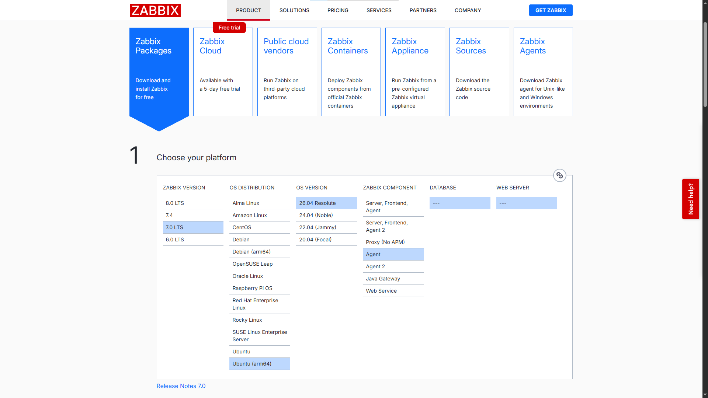
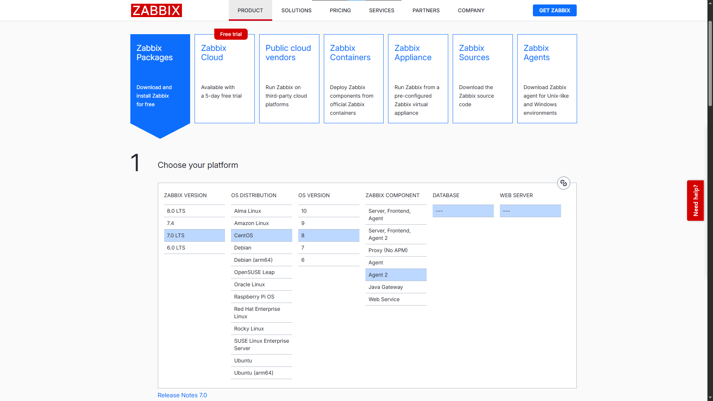
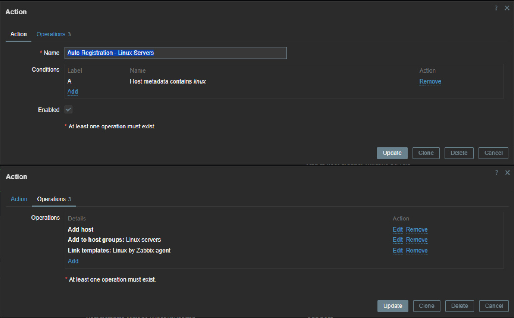
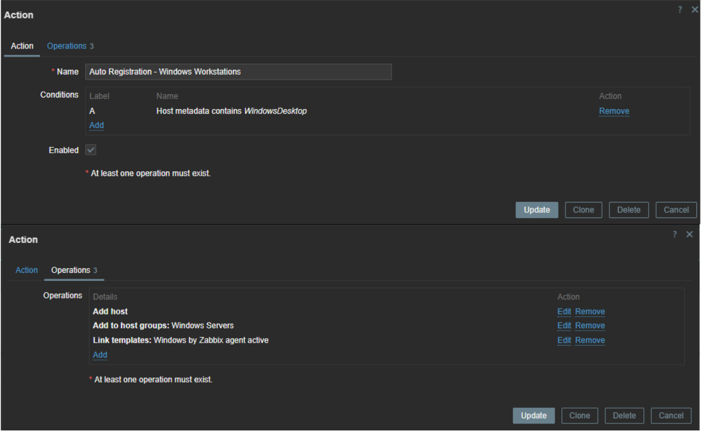

#  Módulo 2: Agentes Distribuídos, Auto Registration e Criptografia TLS/PSK

Documentação técnica passo a passo da expansão do laboratório para o monitoramento distribuído multi-plataforma (**Ubuntu**, **CentOS** e **Windows**), detalhando a arquitetura de coletas **Passivas e Ativas** (contornando redes restritas com NAT/CGNAT), o provisionamento zero-touch via **Auto Registration** e a criptografia ponta a ponta com chaves pré-compartilhadas (**TLS/PSK de 256 bits**).

---

##  Passo 1: Arquitetura de Conectividade dos Agentes (Passivo vs. Ativo)

O laboratório foi projetado para validar três cenários distintos de conectividade corporativa que se comunicam com o **Zabbix Server (`zbx-lab.space` / `150.136.108.22` / `10.0.0.161`)**:

| Hostname | Sistema Operacional | Tipo de Agente | Topologia de Rede | Modo de Operação | Metadado (`HostMetadata`) |
| :--- | :--- | :--- | :--- | :--- | :--- |
| **`HostCloud-A`** | Ubuntu 26.04 LTS | Zabbix Agent (Clássico) | Rede Privada OCI (`10.0.0.176`) | Híbrido (Passivo + Ativo via IP Privado) | `linux` |
| **`HostCloud-B`** | CentOS 8 / Stream | Zabbix Agent 2 | Nuvem Externa / IP Público (`129.80.172.178`) | Híbrido (Passivo + Ativo via FQDN) | `linux` |
| **`DESKTOP-SGH3G6V`** | Windows 10 | Zabbix Agent 2 | Rede Doméstica / Corporativa sob **CGNAT** (`45.163.168.157`) | **100% Ativo** (Inicia conexão na porta `10051`) | `WindowsDesktop` |

> **Por que usar o Modo Ativo no Windows sob CGNAT?** Em provedores de internet que utilizam *Carrier-Grade NAT (CGNAT)*, não é possível abrir portas de entrada (`10050/TCP`) para que o Zabbix Server consulte o host passivamente. No modo **Ativo (`ServerActive`)**, o próprio agente Windows inicia a conexão de saída até a porta `10051/TCP` do servidor na nuvem (`zbx-lab.space`), baixando a lista de métricas solicitadas e enviando os resultados periodicamente sem necessidade de redirecionamento de portas local.

---

##  Passo 2: Implantação do Agente Linux em Rede Local (`HostCloud-A`)

O nó **`HostCloud-A`** reside na mesma Virtual Cloud Network (VCN) do Zabbix Server na Oracle Cloud, permitindo comunicação direta de baixa latência pelo endereço privado `10.0.0.161`.

### 1. Instalar o pacote do Zabbix Agent no Ubuntu

```bash
sudo wget https://repo.zabbix.com/zabbix/7.0/ubuntu-arm64/pool/main/z/zabbix-release/zabbix-release_latest_7.0+ubuntu26.04_all.deb
sudo dpkg -i zabbix-release_latest_7.0+ubuntu26.04_all.deb
sudo apt update
sudo apt install -y zabbix-agent
```

### 2. Parametrizar o arquivo `/etc/zabbix/zabbix_agentd.conf`
Edite o arquivo de configuração do agente clássico:
```bash
sudo nano /etc/zabbix/zabbix_agentd.conf
```
Diretivas ativas configuradas (arquivo higienizado disponível em [`configs/zabbix_agentd_ubuntu.conf`](../configs/zabbix_agentd_ubuntu.conf)):
```ini
PidFile=/run/zabbix/zabbix_agentd.pid
LogFile=/var/log/zabbix/zabbix_agentd.log
LogFileSize=0
Server=10.0.0.161
ServerActive=10.0.0.161
Hostname=HostCloud-A
HostMetadata=linux
Include=/etc/zabbix/zabbix_agentd.d/*.conf
```

### 3. Liberar o Firewall e habilitar o serviço
No firewall do **`HostCloud-A`**, as portas `ICMP` e `10050/TCP` foram liberadas exclusivamente para o IP privado do Zabbix Server (`10.0.0.161/32`):
```bash
sudo systemctl restart zabbix-agent
sudo systemctl enable zabbix-agent
sudo systemctl status zabbix-agent
```

---

##  Passo 3: Implantação do Zabbix Agent 2 Multi-Cloud (`HostCloud-B`)

O servidor **`HostCloud-B`** (CentOS) simula o monitoramento de uma instância externa comunicando-se pela internet com o domínio `zbx-lab.space` e utilizando o **Zabbix Agent 2** (desenvolvido em Go, com suporte nativo a plugins e checagens concorrentes).

### 1. Adicionar o repositório RPM oficial e instalar o Zabbix Agent 2

```bash
sudo rpm -Uvh https://repo.zabbix.com/zabbix/7.0/centos/8/x86_64/zabbix-release-latest-7.0.el8.noarch.rpm
sudo dnf clean all
sudo dnf install -y zabbix-agent2 zabbix-agent2-plugin-*
```

### 2. Parametrizar o arquivo `/etc/zabbix/zabbix_agent2.conf`
```bash
sudo nano /etc/zabbix/zabbix_agent2.conf
```
Diretivas ativas configuradas (arquivo higienizado disponível em [`configs/zabbix_agent2_centos.conf`](../configs/zabbix_agent2_centos.conf)):
```ini
PidFile=/run/zabbix/zabbix_agent2.pid
LogFile=/var/log/zabbix/zabbix_agent2.log
LogFileSize=0
Server=zbx-lab.space
ServerActive=zbx-lab.space
Hostname=HostCloud-B
HostMetadata=linux
PluginSocket=/run/zabbix/agent.plugin.sock
ControlSocket=/run/zabbix/agent.sock
Include=/etc/zabbix/zabbix_agent2.d/plugins.d/*.conf
Include=/etc/zabbix/zabbix_agent2.d/*.conf
```

### 3. Regras de Perímetro e Inicialização
As portas de entrada `10050/TCP` e `10051/TCP` no **`HostCloud-B`** foram restritas exclusivamente ao IP público do Zabbix Server (`150.136.108.22/32`):
```bash
sudo systemctl restart zabbix-agent2
sudo systemctl enable zabbix-agent2
sudo systemctl status zabbix-agent2
```

---

## 🪟 Passo 4: Implantação do Zabbix Agent 2 no Windows (`DESKTOP-SGH3G6V`)

A estação de trabalho Windows (**`DESKTOP-SGH3G6V` / `MEU DESKTOP`**) foi integrada ao laboratório utilizando o instalador oficial MSI do **Zabbix Agent 2 (64-bit)**.

### 1. Parâmetros definidos no Assistente de Instalação (MSI)
* **Host name:** `DESKTOP-SGH3G6V`
* **Zabbix server IP/DNS:** `zbx-lab.space`
* **Agent listen port:** `10050`
* **Server or Proxy for active checks:** `zbx-lab.space`
* **Enable PSK:** Habilitado
* **Add agent location to the PATH:** Habilitado

### 2. Revisão do arquivo `C:\Program Files\Zabbix Agent 2\zabbix_agent2.conf`
Para acionar o fluxo de descoberta automática e leitura de eventos do Windows, a diretiva `HostMetadata` foi adicionada ao arquivo de configuração (disponível em [`configs/zabbix_agent2_windows.conf`](../configs/zabbix_agent2_windows.conf)):
```ini
LogFile=C:\Program Files\Zabbix Agent 2\zabbix_agent2.log
Server=zbx-lab.space,127.0.0.1
ServerActive=zbx-lab.space
Hostname=DESKTOP-SGH3G6V
HostMetadata=WindowsDesktop
ControlSocket=\\.\pipe\agent.sock
Include=.\zabbix_agent2.d\plugins.d\*.conf
Include=C:\Program Files\Zabbix Agent 2\zabbix_agent2.d\
```

Após salvar o arquivo no Bloco de Notas (executado como Administrador), o serviço **Zabbix Agent 2** foi reiniciado pelo console de serviços do Windows (`services.msc` ou via PowerShell):
```powershell
Restart-Service -Name "Zabbix Agent 2"

```

---

## ⚡ Passo 5: Automação de Cadastro com Auto Registration

Para eliminar o trabalho manual de cadastrar cada host na interface web, foram configuradas regras de **Auto Registration** baseadas no valor enviado pela diretiva `HostMetadata` quando o agente se conecta pela primeira vez na porta `10051`.

### Configuração no Zabbix Frontend
No menu lateral, acesse **Alerts > Actions > Autoregistration actions** e clique em **Create action**:

#### Regra 1: Onboarding Automático de Servidores Linux
* **Name:** `Auto Registration - Linux Servers`
* **Conditions:** `Host metadata` *contains* `linux`
* **Operations:**
  1. **Add host** (cadastra o nó automaticamente no inventário).
  2. **Add to host group:** `Linux servers`.
  3. **Link templates:** `Linux by Zabbix agent` (ou `Linux by Zabbix agent active`).
  

#### Regra 2: Onboarding Automático de Estações Windows
* **Name:** `Auto Registration - Windows Workstations`
* **Conditions:** `Host metadata` *contains* `WindowsDesktop`
* **Operations:**
  1. **Add host**
  2. **Add to host group:** `Windows servers` / `Workstations`.
  3. **Link templates:** `Windows by Zabbix agent active`.
  

---

