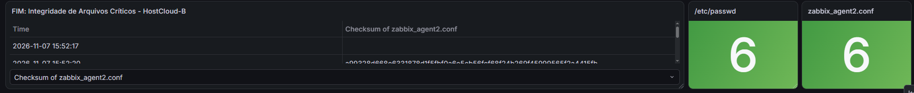
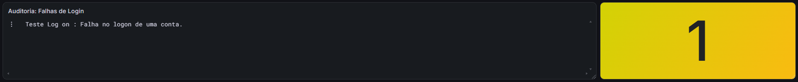
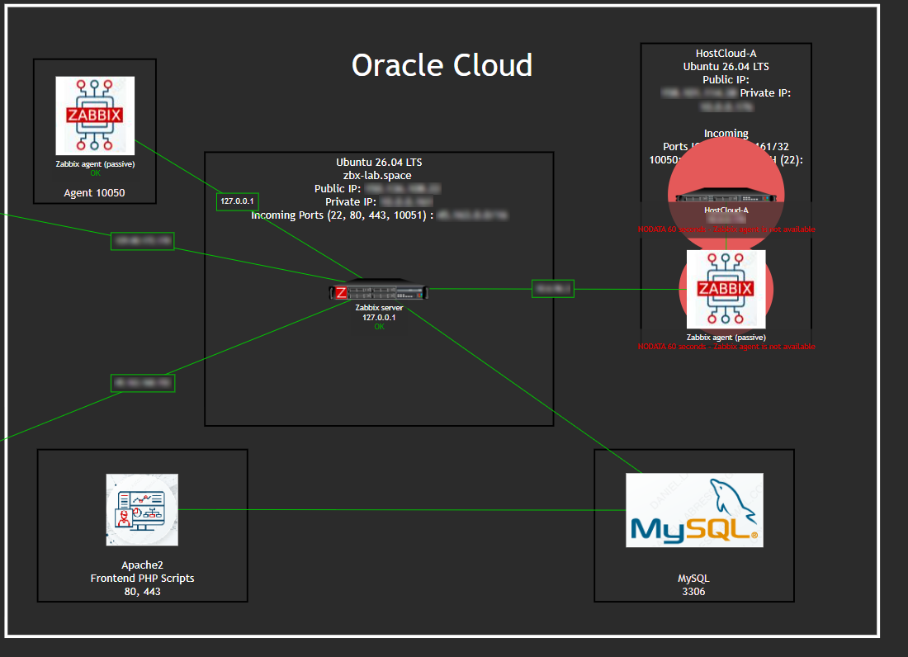
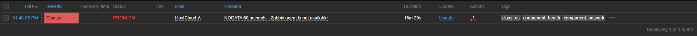
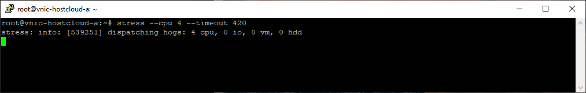
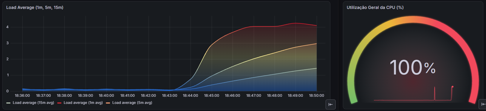
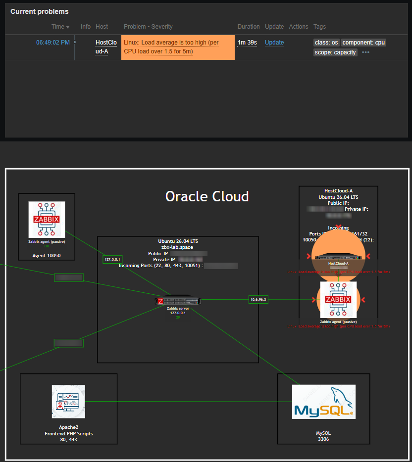
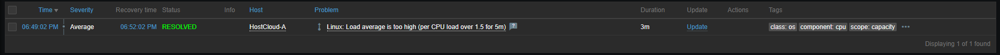

#  Módulo 3: Itens, Triggers, Visualização e Alertas

Este módulo documenta a camada de telemetria, inteligência analítica e visualização do laboratório com **Zabbix 7.0 LTS** e **Grafana**. Aqui, a coleta bruta dos agentes é estruturada em itens passivos, ativos e dependentes, governada por **Tags**, avaliada por expressões lógicas (**Triggers**), padronizada em **Templates** exportáveis e validada com testes controlados de injeção de falhas.

---

##  Passo 1: Arquitetura de Coleta e Governança por Tags

Para equilibrar profundidade técnica e baixo consumo de recursos, a coleta foi desenhada aplicando três práticas de engenharia:

1. **Itens Dependentes (*Dependent Items*):** Métricas calculadas como `CPU utilization` (derivada de `CPU idle time`) e `Memory utilization` (derivada de `Available memory in %`) são processadas diretamente no Zabbix Server sem gerar requisições duplicadas aos agentes.
2. **Monitoramento de Integridade de Arquivos (FIM / SecOps):** Verificação periódica via hash `SHA-256` em arquivos sensíveis do Linux (`/etc/passwd`, `zabbix_agentd.conf` e `zabbix_agent2.conf`) para detectar alterações não autorizadas.
3. **Taxonomia Padronizada por Tags:** Classificação consistente em todos os itens (`component: cpu`, `memory`, `storage`, `security`, `health`, `network`, `system`, `class: os` e `target: linux/windows`) para facilitar filtros, correlação de eventos e consultas no Grafana.

### 1. Catálogo de Telemetria — Linux (`HostCloud-A` e `HostCloud-B` — 21 Itens)
Coleta passiva (`Zabbix agent`) com retenção de histórico de `31d`, tendências de `365d` (exceto uptime e checksums) e intervalos ajustados entre `30s` e `15m`:

| Categoria (Tag) | Nome do Item | Chave (*Key*) | Tipo | Intervalo |
| :--- | :--- | :--- | :--- | :--- |
| `component: health` | **Zabbix Agent Ping** | `agent.ping` | Zabbix agent | `1m` |
| `component: system` | **System uptime** | `system.uptime` | Zabbix agent | `30s` |
| `component: system` | **Number of processes** | `proc.num` | Zabbix agent | `1m` |
| `component: cpu` | **Number of CPUs** | `system.cpu.num` | Zabbix agent | `1m` |
| `component: cpu` | **CPU (User) / CPU idle time** | `system.cpu.util[,user]` / `[,idle]` | Zabbix agent | `1m` |
| `component: cpu` | **CPU utilization** *(Derivado)* | `system.cpu.util` | **Dependent item** | — |
| `component: cpu` | **Load average (1m / 5m / 15m)** | `system.cpu.load[all,avg1..15]` | Zabbix agent | `1m` |
| `component: memory` | **Total / Available memory** | `vm.memory.size[total]` / `[available]` | Zabbix agent | `1m` |
| `component: memory` | **Available memory in %** | `vm.memory.size[pavailable]` | Zabbix agent | `1m` |
| `component: memory` | **Memory utilization** *(Derivado)* | `vm.memory.util` | **Dependent item** | — |
| `component: memory` | **Swap (Total / Free / Free %)** | `system.swap.size[,total..pfree]` | Zabbix agent | `1m` |
| `component: storage` | **Free Space (`/`)** | `vfs.fs.size[/,free]` | Zabbix agent | `1m` |
| `component: security` | **Checksum of `/etc/passwd`** | `vfs.file.cksum[/etc/passwd,sha256]` | Zabbix agent | `15m` |
| `component: security` | **Checksum of `zabbix_agentd.conf`** | `vfs.file.cksum[/etc/zabbix/zabbix_agentd.conf,sha256]` | Zabbix agent | `15m` |
| `component: security` | **Checksum of `zabbix_agent2.conf`** | `vfs.file.cksum[/etc/zabbix/zabbix_agent2.conf,sha256]` | Zabbix agent | `15m` |

### 2. Catálogo de Telemetria — Windows (`WIN-WORKSTATION-01` — 18 Itens)
Como a estação Windows opera atrás de **CGNAT**, todos os itens mestres utilizam **`Zabbix agent (active)`**, enviando dados de saída para a porta `10051` do Zabbix Server:

| Categoria (Tag) | Nome do Item | Chave (*Key*) | Tipo | Intervalo |
| :--- | :--- | :--- | :--- | :--- |
| `component: health` | **Zabbix Agent Ping** | `agent.ping` | Zabbix agent (active) | `1m` |
| `component: system` | **System uptime** | `system.uptime` | Zabbix agent (active) | `30s` |
| `component: system` | **Number of processes** | `proc.num` | Zabbix agent (active) | `1m` |
| `component: cpu` | **Number of CPUs** | `system.cpu.num` | Zabbix agent (active) | `1m` |
| `component: cpu` | **CPU utilization (Atual / 1m / 5m / 15m)** | `system.cpu.util` / `[,,avg1..15]` | Zabbix agent (active) | `1m` |
| `component: memory` | **Total / Free / Available memory** | `vm.memory.size[total..available]` | Zabbix agent (active) | `1m` |
| `component: memory` | **Available memory in %** | `vm.memory.size[pavailable]` | Zabbix agent (active) | `1m` |
| `component: memory` | **Memory utilization** *(Derivado)* | `vm.memory.util` | **Dependent item** | — |
| `component: memory` | **Swap (Total / Free / Free %)** | `system.swap.size[,total..pfree]` | Zabbix agent (active) | `1m` |
| `component: storage` | **Free Space (`C:`)** | `vfs.fs.size[C:,free]` | Zabbix agent (active) | `1m` |
| `component: security` | **Falha no Login (Event ID 4625)** | `eventlog[Security,,,,4625,,skip]` | Zabbix agent (active) | `1m` |

---

##  Passo 2: Modelagem de Triggers Analíticas e Controle de Flapping

Com a telemetria validada em **Monitoring > Latest data**, foram criadas regras lógicas para detecção proativa de indisponibilidade, saturação de hardware e eventos de segurança:

| Escopo / Métrica | Trigger Configurada | Severidade | Lógica Operacional |
| :--- | :--- | :--- | :--- |
| **Disponibilidade** | **NODATA 60 seconds** (`agent.ping`) | `Disaster` | Dispara alerta crítico caso o agente fique 60 segundos sem comunicação. |
| **Armazenamento** | **Less than 5GB free** (`vfs.fs.size`) | `High` | Alerta quando o espaço livre em disco cai abaixo de 5 GB (`5000000000` bytes). |
| **Processamento** | **High CPU Usage 75% (2m / 5m)** | `Warning` | Avalia média móvel (`avg5` / `2m`) para evitar falsos positivos em picos curtos. |
| **Fila Linux** | **Load Average (1m / 5m / 15m)** | `Warning` / `Average` | Monitora sobrecarga de fila de processos correlacionada ao `Number of CPUs`. |
| **Hardware** | **Alteração em `Number of CPUs`** | `Information` | Detecta mudanças de alocação de vCPUs/OCPUs nas instâncias em nuvem. |
| **Segurança (Windows)** | **Falha no Login (Event ID 4625)** | `Average` | Dispara alerta imediato ao identificar tentativas inválidas de logon no Security Log. |

### Boas Práticas Aplicadas nas Triggers
- **Macros Dinâmicas:** Uso de `{ITEM.VALUE}` nos nomes das triggers para exibir a leitura exata no momento do disparo.
- **Mitigação de *Alert Flapping*:** Ajuste de expressão de recuperação (*OK event generation*) e habilitação de fechamento manual (*Allow manual close*) em eventos pontuais de segurança.

---

##  Passo 3: Padronização em Templates e Versionamento

Para garantir escalabilidade e replicação rápida em novos servidores:
1. Os itens mestres, itens dependentes, tags, triggers e gráficos foram consolidados em templates customizados por sistema operacional em **Data collection > Templates**.
2. Os modelos e a definição do mapa foram exportados e versionados em [`templates/`](../templates/) (`YAML` e `JSON`), permitindo restauração imediata do ambiente como código.

---

## 🗺️ Passo 4: Estratégia de Visualização (Zabbix vs. Grafana)

A camada visual do NOC foi dividida respeitando o ponto forte de cada plataforma:

| Ferramenta | Papel na Arquitetura | O que Exibe |
| :--- | :--- | :--- |
| **Zabbix Frontend** | **Operação e Gestão de Incidentes (NOC)** | Saúde de itens/tags, ciclo de vida de triggers (`PROBLEM` / `RESOLVED`) e **Mapa Topológico de Rede** dinâmico. |
| **Grafana** | **Observabilidade Analítica e Executiva** | Dashboards consolidados consumindo dados do Zabbix via API (CPU, Memória/Swap, Disco, Tráfego de Rede, FIM e SLA/Uptime). |

### 1. Mapa Topológico de Rede (Zabbix Native Map)
Documenta a infraestrutura na **Oracle Cloud (OCI)** e a estação Windows em **Network A (CGNAT)**, indicando tipos de agentes (Passivo/Ativo), portas (`22`, `80`, `443`, `3306`, `10050`, `10051`) e status em tempo real vinculados às triggers de cada host:

### 2. Painéis Executivos (Grafana)
Visualização unificada das métricas coletadas pelo Zabbix *(nota: painéis sinalizados com `LLD` estão estruturados no dashboard e serão populados na etapa de Low-Level Discovery do Módulo 5)*:

- **Disponibilidade (SLA) e Uptime:**
  .png)
- **Processamento, Memória e Swap:**
  .png)
  
- **Segurança, FIM (Checksums SHA-256) e Auditoria:**
  
  

---

##  Passo 5: Canais de Notificação (Media Types & Actions)

1. **Configuração SMTP (`Alerts > Media types > Email`):** Parametrização de servidor SMTP autenticado com criptografia TLS/SSL e validação via botão **Test**.
2. **Associação ao Usuário (`Users > Users > Admin > Media`):** Definição do destinatário e filtro por severidade (`Warning`, `Average`, `High` e `Disaster`).
3. **Regra de Disparo (`Alerts > Actions > Trigger actions`):** Ativação da ação *Report problems to Zabbix administrators*, contemplando notificações de abertura e recuperação (*Recovery*).

*(Nota de Evolução: Integrações via Webhooks com **Slack** e **Telegram** estão previstas nas próximas atualizações do laboratório).*

---

##  Passo 6: Validação Operacional (Simulação de Incidentes)

Para comprovar a eficácia das regras de alerta, da correlação por dependência de triggers e da atualização visual em tempo real, foram executados dois testes controlados de injeção de falha no nó **`HostCloud-A`**:

| Cenário Simulado | Ação Executada no Host | Comportamento Validado (Zabbix + Grafana) |
| :--- | :--- | :--- |
| **1. Queda do Agente (`NODATA 60s`)** | Interrupção do serviço: `systemctl stop zabbix-agent` | O indicador `ZBX` ficou vermelho, a trigger **`NODATA 60 seconds`** disparou em severidade `Disaster` e o painel de disponibilidade no **Grafana** alterou o estado de `ON` para **`OFF`** a vermelho. Após `systemctl start zabbix-agent`, o estado normalizou automaticamente. |
| **2. Sobrecarga de CPU (`stress`)** | Execução de carga sintética por 7 minutos: `stress --cpu 4 --timeout 420` | A CPU atingiu **100%** e o Load Average (`1m`) superou `4` no **Grafana**. Após 5 minutos acima do limiar, a trigger **`Linux: Load average is too high (per CPU load over 1.5 for 5m)`** (`Average`) disparou no **Zabbix** e destacou o `HostCloud-A` no **Mapa Topológico**, suprimindo a trigger dependente de CPU para evitar alertas duplicados. Ao fim do teste, o evento mudou automaticamente para **`RESOLVED`** após `3m` de duração. |

### Evidências Visuais dos Testes de Resiliência

#### 1. Simulação de Indisponibilidade (`NODATA 60s`)
- **Reflexo da queda do agente no painel de Disponibilidade (SLA) do Grafana:**
   
   
   

#### 2. Simulação de Sobrecarga de CPU (`stress --cpu 4 --timeout 420`)
- **Injeção controlada de carga no terminal SSH do `HostCloud-A`:**
  
- **Pico de Load Average e 100% de utilização de CPU em tempo real no Grafana:**
  
- **Trigger ativa em `Current problems` e alteração dinâmica no Mapa Topológico do NOC:**
  
- **Encerramento e recuperação automática do incidente (`RESOLVED` após 3 minutos):**
  

---

[⬅️ Voltar ao Módulo 2](./02-agentes-e-automacao.md) | [🏠 Voltar ao Início](../README.md) | [➡️ Avançar para o Módulo 4](./04-logs-web-e-preprocessamento.md)
