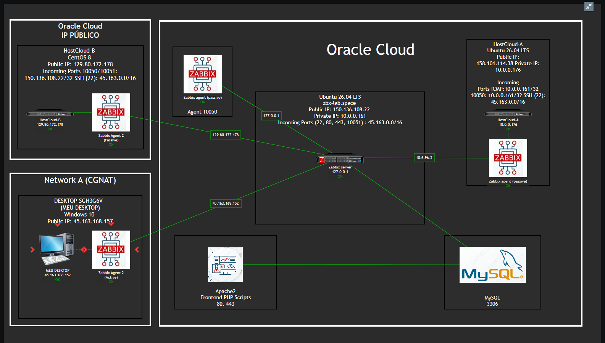
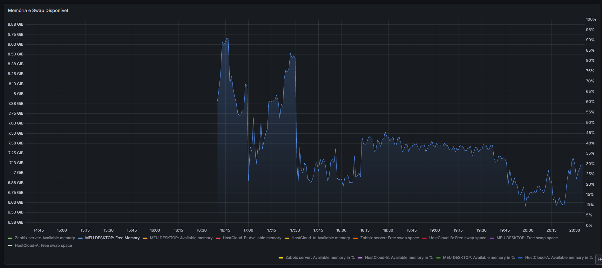
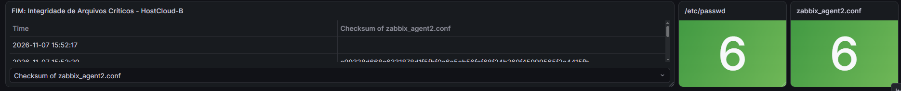
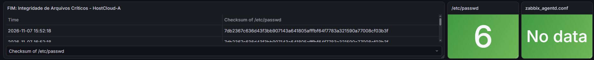
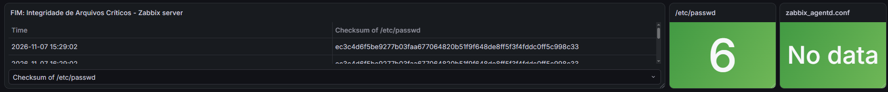
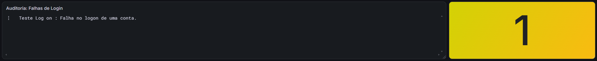

## 🖼️ Galeria de Evidências (NOC & Grafana)

### 1. Topologia de Rede e Conectividade (Zabbix Map)
Mapeamento ativo na Oracle Cloud (OCI) detalhando IPs públicos/privados, regras de Firewall/Portas e agentes operando em modo passivo e ativo (contornando CGNAT):

### 2. Disponibilidade (SLA) e Uptime
.png)
.png)

### 3. Desempenho de Processamento, Memória e Disco (I/O)
.png)
.png)

.png)
(lld).png)

### 4. Tráfego de Rede e Auditoria de Segurança (FIM & Logon)
Monitoramento de integridade de arquivos críticos (`/etc/passwd` e arquivos `.conf` via checksum) e auditoria de falhas de login:
-(lld).png)

